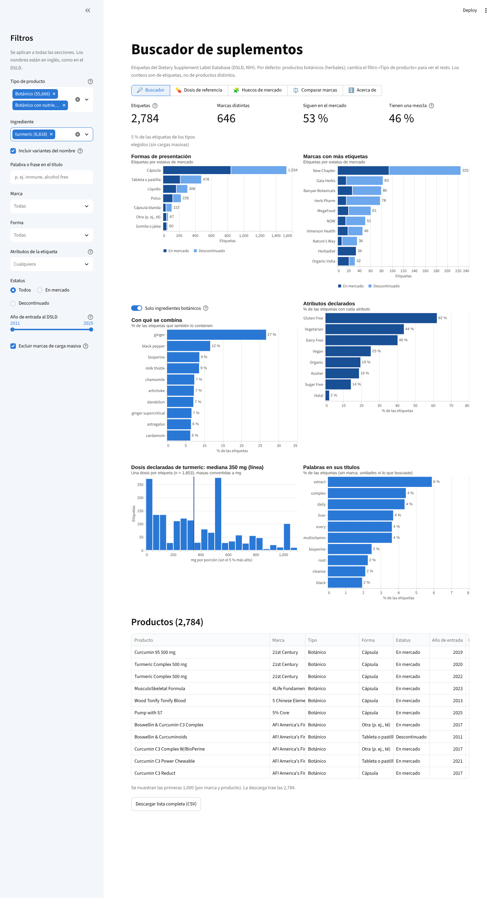

# Buscador de suplementos (DSLD) · Dietary supplement label search

**English summary.** An interactive **Streamlit app** to search the NIH [Dietary Supplement Label Database (DSLD)](https://dsld.od.nih.gov/): **214,780 U.S. supplement labels** of every product type. It opens with all product types and a filter lets you narrow to, e.g., botanical (herbal) products only, vitamins, minerals, amino acids or fats. Built for product developers: search by ingredient, title keyword, brand, form or label claim (vegan, organic…), get reference dose ranges by form, spot ingredient × form gaps, compare brands. Built with Python, pandas, Altair and Streamlit, with a documented, auditable ingredient-name normalization (see METODOLOGIA.md).

**App:** [abrir el buscador](https://supplement-label-search.streamlit.app/)



## Qué hay aquí

```
├── app/                       ← app de Streamlit
│   ├── app.py
│   ├── datos/                 ← datos ya preparados (Parquet) y agrupaciones.csv (~26 MB)
│   └── capturas/
├── utilidades/
│   ├── dsld_extract_json.py   ← extrae campos del JSON del DSLD
│   ├── preparar_datos.py      ← genera los datos de la app (limpieza y agrupación de ingredientes)
│   ├── calificadores.csv      ← palabras que se quitan o no del nombre (con su criterio)
│   ├── sinonimos.csv          ← reglas de sinónimos (con su criterio)
│   └── candidatos_calificadores.py ← lista de palabras candidatas a revisar
├── METODOLOGIA.md             ← cómo se agrupan los nombres de ingredientes, con casos y límites
├── requirements.txt           ← dependencias de la app
└── DESPLIEGUE.md              ← cómo publicar la app gratis en Streamlit Community Cloud
```

## La app

Pensada para **desarrollo de producto**. La app abre con **todos los tipos de producto** (214,780 etiquetas) y sin filtros; el filtro **Tipo de producto** (lista de casillas: *Todos* marca o desmarca todas, «Mostrar más» despliega el resto) permite acotar, por ejemplo, a los botánicos (*Botanical* y *Botanical with Nutrients*), vitaminas, minerales, aminoácidos o grasas. Los filtros de la barra lateral (tipo, ingrediente, término en el nombre original del ingrediente, palabra del título, marca, forma, atributos, estatus y año) se aplican a cinco secciones:

- **Buscador:** indicadores, formas, marcas, con qué se combina, atributos declarados, dosis y palabras de los títulos, más la lista de productos con link a la etiqueta original y descarga en CSV.
- **Dosis de referencia:** rango de dosis declaradas de un ingrediente por forma (P10, Q1, mediana, Q3, P90), en la unidad más usada del ingrediente.
- **Huecos de mercado:** mapa ingrediente × forma con el número de etiquetas; las celdas claras son combinaciones poco exploradas.
- **Comparar marcas:** hasta tres marcas lado a lado (formas, atributos e ingredientes principales).
- **Altas por año:** cuántas etiquetas entraron al DSLD cada año (en número o como % de las altas del año), con desglose por estatus, tipo de producto o forma. Es el año de alta en la base, no el de lanzamiento: sirve como referencia de tendencia.

Para correrla en tu computadora:

```bash
pip install -r requirements.txt
streamlit run app/app.py
```

Para regenerar los datos (por ejemplo, con una descarga más reciente del DSLD):

```bash
python utilidades/dsld_extract_json.py DSLD-full-database-JSON.zip dsld_json_extra.csv
python utilidades/preparar_datos.py DSLD-full-database-CSV/ dsld_json_extra.csv
```

## Decisiones que conviene conocer

- **Cargas masivas:** cuatro marcas (TerraVita Premium Collection, TerraVita, Herbal Terra y Hawaii Pharm) subieron miles de etiquetas por lotes y pueden distorsionar los resultados (sobre todo las tendencias por año); la app trae una casilla para excluirlas, desactivada por defecto.
- **Año de entrada ≠ lanzamiento:** es la fecha en que se capturó la etiqueta en el DSLD.
- **Etiquetas, no productos:** una misma presentación puede tener varias etiquetas (tamaños, sabores).
- **Nombres de ingredientes:** se agrupan por reglas en tres capas (limpieza, tabla de sinónimos y comparación automática de escritura): *turmeric root extract* cuenta como *turmeric*, *ascorbic acid* = *vitamin C*, *L-glutamine* = *glutamine*. Es una aproximación auditable: `app/datos/agrupaciones.csv` dice a qué ingrediente fue cada nombre y con qué regla, y la app lo muestra al elegir un ingrediente. Detalle y límites en [METODOLOGIA.md](METODOLOGIA.md).
- **Información nutrimental:** las filas de calorías, grasa total, carbohidratos y azúcares se quitan de la lista de ingredientes.
- **Dosis estandarizadas:** son las de la etiqueta por porción. La masa (g, mg, mcg) se lleva a una base común, la vitamina D se convierte de IU a mcg, y para cada ingrediente se usa la unidad que más etiquetas declaran; las IU de las vitaminas A y E no se mezclan con masas porque dependen de la forma química. La app muestra cuántas etiquetas entran en cada caso, y la sección *Dosis de referencia* explica el método.

## Limitaciones

- Los datos son lo **declarado en etiquetas**; el NIH no verifica su exactitud.
- No hay ventas ni demanda: el proyecto describe qué existe, no qué se vende ni qué funciona.
- Son datos de EE. UU.; no equivalen al mercado mexicano.

## Fuente de los datos

NIH Office of Dietary Supplements, Dietary Supplement Label Database (DSLD), descarga completa de enero de 2026 (214,780 etiquetas).
