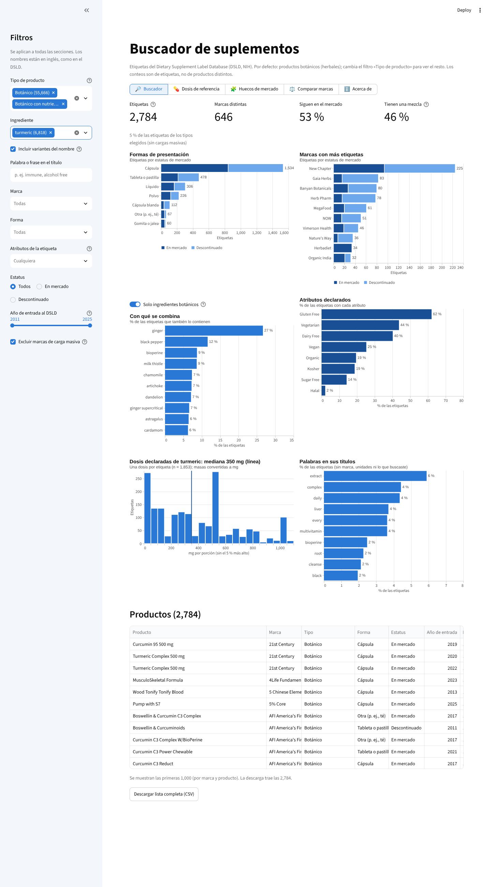

# App · Buscador de suplementos

App de Streamlit para explorar las 214,780 etiquetas del DSLD, pensada para **desarrollo de producto**. Abre filtrada a los productos botánicos (herbales); el filtro **Tipo de producto** permite ver el resto.



## Secciones

- **Buscador:** filtra por tipo de producto, ingrediente, palabra o frase del título, marca, forma, atributos de la etiqueta (*Vegan*, *Organic*, *Gluten Free*…), estatus y año de entrada. Muestra indicadores, formas, marcas, con qué se combina, atributos declarados, dosis (si eliges un ingrediente) y palabras de los títulos. Abajo, la lista de productos con link a la etiqueta original en el DSLD y descarga en CSV.
- **Dosis de referencia:** para un ingrediente, el rango de dosis declaradas por forma (P10 a P90, mitad central y mediana).
- **Huecos de mercado:** mapa de ingrediente × forma con el número (o porcentaje) de etiquetas, para ingredientes botánicos, vitaminas y minerales, aminoácidos o todos.
- **Comparar marcas:** hasta tres marcas lado a lado.
- **Altas por año:** etiquetas que entraron al DSLD cada año, en número o como % de las altas del año, con desglose opcional por estatus, tipo de producto o forma. Es el año de captura en la base, no el de lanzamiento.

Los filtros de la barra lateral se aplican a todas las secciones (en *Comparar marcas* se ignora el filtro de marca).

## Detalles

- **Tipo de producto:** los botones *Todos* y *Botánicos* cambian la selección de golpe; vacío = todos los tipos. Con tipos distintos de botánico, «Con qué se combina» y los mapas pasan solos a incluir vitaminas y minerales.
- **Variantes del nombre:** con la casilla activada, «turmeric» también incluye «turmeric co2», «turmeric 95»… (nombres que contienen esa palabra completa).
- **Dosis:** una por etiqueta (si se repite, la mediana), en la unidad más usada del ingrediente; la masa se muestra en mg o mcg según el tamaño típico. Vitamina D: IU convertidas a mcg. IU de A y E, mL y CFU no se mezclan con masas. Arriba de la gráfica se indica cuántas etiquetas entran, cuántas usan otra unidad y cuántas no declaran cantidad; el detalle del método está en la sección *Dosis de referencia*.
- **Lista de ingredientes:** solo aparecen los que tienen al menos 5 etiquetas.
- **Cargas masivas:** por defecto se excluyen TerraVita Premium Collection, TerraVita, Herbal Terra y Hawaii Pharm.
- En listas muy grandes, las palabras de los títulos se calculan con una muestra de 30,000 etiquetas. La tabla muestra hasta 1,000 productos; la descarga trae todos.

## Datos

`datos/` contiene tres archivos Parquet (~19 MB) generados con `utilidades/preparar_datos.py`:

- `etiquetas.parquet`: una fila por etiqueta (producto, marca, tipo, forma, estatus, año de entrada, porción, contenido, link, si tiene mezcla).
- `ingredientes.parquet`: una fila por ingrediente declarado (nombre original y limpio, categoría, valor y unidad).
- `atributos.parquet`: una fila por etiqueta y atributo declarado (del JSON del DSLD).

## Correrla en local

Desde la raíz del repositorio:

```bash
pip install -r requirements.txt
streamlit run app/app.py
```
